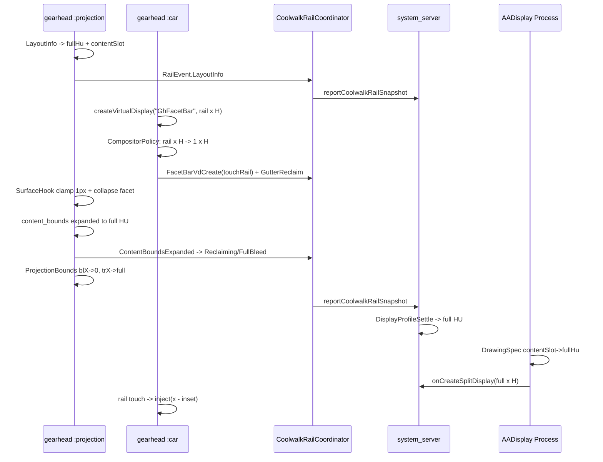

# COOLWALK_FACETBAR.md — FacetBar / Left-Rail Reclamation & Reconnect Resolution

Architecture notes for Coolwalk's left-side **FacetBar** (`GhFacetBar` VirtualDisplay + launcher/dashboard icon column) and **reconnect resolution settlement**.

---

## 1. Background

Android Auto Coolwalk reserves a **vertical navigation rail** (FacetBar) on the left side of the head unit:

| Layer | Native AA Behavior | AADisplay Target |
|-------|--------------------|------------------|
| **Compositor** | Named `GhFacetBar` VirtualDisplay, ~80-107px wide | **Starved to 1xH**, compositor stops reserving slot |
| **Compositor Window Geometry** | `{blX=rail, trX=fullHU}`, slot width = full - rail | `blX->0`, `trX->fullHU` |
| **Layout** | `content_bounds` = `Rect(rail,0,HU-rail,H)` | Expanded to `Rect(0,0,fullHU,H)` |
| **View** | `gh_coolwalk_*facet*` icon column | GONE + 0 width, sibling content MATCH_PARENT |
| **Profile** | Split VD created at content slot (e.g. 720, 1828) | Settled to **full HU** after reclaim (800, 1920...) |
| **Presentation** | `DrawingSpec` width = content slot | Widened to full HU |
| **Touch** | `x < rail` hits FacetBar VD | Intercepted to pane / peel / AA UI (coords subtract compositor inset) |

Desync across layers causes: **left black bar**, **right gutter**, **unresponsive fullscreen peel bar**, or **soft reconnect oscillating between content/full**.

Typical values (all runtime-observed, **no hardcoded resolution table**):

| HU Example | full HU | Rail Width (observed) | content slot | Black Bar Cause |
|------------|---------|-----------------------|--------------|-----------------|
| 800x480 | 800 | ~80 | 720 | blX=80 not zeroed / profile locked to 720 |
| 1280x720 | 1280 | ~107 | 1173 | DrawingSpec still 1173 |
| 1920x1080 | 1920 | ~92-107 | 1828 | blX=92 + inject missing inset subtraction |

---

## 2. End-to-End Pipeline Overview

### 2.1 Processes & Responsibilities

```
gearhead :projection                          gearhead :car
├─ CoolwalkFacetBarSurfaceHook  clamp surf W  ├─ AaCoolwalkLayoutHook       rail dimen -> 0
├─ CoolwalkFacetChrome          collapse view ├─ AaCoolwalkCompositorHook   VD starve/expand
├─ AaCoolwalkLayoutHook         LayoutInfo    ├─ CoolwalkFacetChrome        collapse view
├─ AaCoolwalkProjectionHook     content_bounds├─ AaCoolwalkHuTouchHook      HU touch intercept
├─ AaCoolwalkCompositorHook     VD policy     ├─ CoolwalkProjectionBoundsHook  zero blX
├─ CoolwalkProjectionBoundsHook expand blX    └─ AaCoolwalkProjectionHook   content_bounds mirror
└─ CoolwalkRailCoordinator <── RailEvent ──> (IPC) system_server
                                              ├─ CoolwalkRailStore (Settings.Global mirror)
                                              └─ DisplayProfileSettle -> profile lock

io.github.nitsuya.aa.display (AADisplay process)
└─ AaDisplayProcessHook -> CoolwalkDrawingSpecWiden  (widen DrawingSpec / presentation)
```

**Single source of truth:** all FacetBar-related hooks in gearhead only read/write `RailSnapshot` via `CoolwalkRailCoordinator.onEvent`, then `NotifyServer` to system_server. Never cache HU width privately in individual modules.

### 2.2 Typical Cold-Connect Sequence



### 2.3 Soft Reconnect

The gearhead process stays alive across disconnects; when AA reconnects:

1. `AaCoolwalkProjectionHook` detects projection config republication -> `onProjectionConfigSignal`.
2. Gap since last config > 8s or phase needs reset -> `RailEvent.ReconnectStarted` (clears previous car's HU / contentSlot).
3. **Regardless of reset, reclaim still runs:** `reclaimAllWindowGutters` + `scheduleEnsureFacetBar` + `starveSurvivingFacetBarVds` (250ms / 1s retries).
4. `CoolwalkRailStore.markReconnectEpoch` + `SETTINGS_RECONNECT_UPTIME_MS` provide idempotency for `content_bounds`.

---

## 3. Resolution Adaptation Model (`CoolwalkRailMath`)

**Principle:** Do not adapt to an "800 / 1280 / 1920" table; adapt only to **three runtime observations** + **physical FacetBar UI constants**.

### 3.1 Three Observations (`RailSnapshot`)

| Field | Source | Purpose |
|-------|--------|---------|
| `fullHuWidthPx` | LayoutInfo canvas, VirtualDevice, `ContentBoundsExpanded` | True HU width; DrawingSpec widen target; profile settle |
| `contentSlotWidthPx` | LayoutInfo narrow width, `rememberContentSlotWidth` | **Retained after reclaim**; computes compositor inset; not lost when `layoutWidthPx` promotes |
| `touchRailWidthPx` | `FacetBarVdCreate` / VD observation | **Only** HU touch hit strip width; **forbidden** for profile |

Auxiliary fields:

| Field | Description |
|-------|-------------|
| `layoutWidthPx` | Most recent LayoutInfo width; may promote to fullHu after `ContentBoundsExpanded` |
| `effectiveRailWidthPx` | Target always 0 (no rail for content/profile) |
| `facetDisplayId` | displayId of named FacetBar VD (for touch CarDisplayId matching) |

`contentSlotWidthPx` lifecycle:

- `LayoutInfo`: `rememberContentSlotWidth(width, fullHu, previous)` — records content slot when `width < fullHu`.
- `ContentBoundsExpanded`: `layoutWidthPx` promotes to fullHu, **`contentSlotWidthPx` stays unchanged** (inset still usable).
- `FullBleed` stable (`fullBleedStableCount >= 3`): `contentSlotWidthPx -> 0` (inset no longer needed).
- `ReconnectStarted`: resets entire `RailSnapshot`.

### 3.2 Physical Constants (Not Resolution-Specific)

Defined in `CoolwalkRailMath`:

| Constant | Value | Meaning |
|----------|-------|---------|
| `absoluteFacetRailBand()` | 32..160 px | Physical width band of Coolwalk vertical rail (same chrome across HUs) |
| `RAIL_MEASUREMENT_JITTER_PX` | 20 px (or max with touchRail/5) | Allowed deviation between VD-reported rail width and compositor `blX` (e.g. 107 vs 92) |
| Single-rail upper bound | `min(15% x fullHu, 160)` | Rejects double-rail gaps (720+80+80->880) being misread as full HU |

**Never** use `fullHu x 5%` as the rail width lower bound (on 1920 HU that yields 96px, rejecting a real 92px rail and breaking the entire reclaim chain).

### 3.3 Core Predicates (Unified Entry Point)

```text
gap = fullHuWidthPx - reportedOrSlotWidth

isPlausibleRailGap(gap, fullHu, touchRail):
  gap in 32..160
  AND (|gap - touchRail| <= jitter  OR  gap <= min(15% x fullHu, 160))

isContentSlotVsFull(reportedW, fullW, touchRail):
  isPlausibleRailGap(fullW - reportedW, fullW, touchRail)

compositorLeftInsetPx(snapshot):
  if FullBleed is stable -> 0
  else inset = fullHu - contentSlotWidthPx (fallback: layoutWidthPx if still narrower than full)
  return inset only if isPlausibleRailGap(inset, fullHu, touchRail)
```

`DisplayProfileSettle.isContentSlotVsFull` **delegates** to `CoolwalkRailMath` (with `CoolwalkRailStore.serverSnapshot.touchRailWidthPx`) to avoid divergent rules between system_server and gearhead.

### 3.4 Geometry Merging (Car Switch / Soft Reconnect)

`pickConnectionFullHuWidth` + `isSameHuGeometry`: full and content slot can infer each other within the same connection; **different HU heights or non-rail-aligned sibling widths** refuse to merge to prevent cross-car contamination.

`ReconnectStarted` clears `fullHu` / `contentSlot` so the next connection's LayoutInfo is the sole truth.

---

## 4. Hook Entry (`AaUiHook`)

**Registration:** `AndroidAutoHook` -> `AaUiHook` (`:projection` + `:car`).
**DexKit:** `content_bounds`, `onWindowSurfaceAvailable`, HU touch dispatch, `LayoutInfo` (`:projection`), `{blX=` compositor bounds class.

### 4.1 Per-Process Installation Matrix

| Module | `:projection` | `:car` | Notes |
|--------|:-------------:|:------:|-------|
| `CoolwalkDrawingSpecWiden.installGearhead` | yes | yes | Widen DrawingSpec construction inside gearhead |
| `CoolwalkProjectionBoundsHook` | yes | yes | Compositor `{blX}` left-rail inset -> 0, expand `trX` to full |
| `CoolwalkFacetBarSurfaceHook` | yes | yes | `GhFacetBar.onWindowSurfaceAvailable` width -> 1 |
| `AaCoolwalkProjectionHook` | yes | yes | `content_bounds` / `pillar_width` / `content_insets` |
| `AaCoolwalkLayoutHook` (LayoutInfo) | yes | — | Force vertical rail, widen canvas |
| `AaCoolwalkLayoutHook` (rail dimen) | — | yes | `Resources.getDimension*` -> 0 |
| `AaCoolwalkCompositorHook` | yes | yes | Rewrite VD create/resize |
| `CoolwalkFacetChrome` | yes* | yes* | Collapse views; *requires `canHookFacetBar` |
| `AaCoolwalkHuTouchHook` | — | yes | Intercept HU touch + compositor inset |
| `AaCoolwalkAutoOpenHook` | yes | — | Auto-open AADisplay after facet/content_bounds |

**AADisplay process:** `AaDisplayProcessHook` -> `CoolwalkDrawingSpecWiden.installAaDisplayLazy()`.
**Never** resize `AaDisplayActivity` presentation VD inside gearhead (Car SDK Surface is allocated in the AADisplay process; resizing on the gearhead side causes a black screen).

### 4.2 `canHookFacetBar`

`CoolwalkHookEnv.loadProjectionResources()` resolves facet layout id, launcher icon id, and canonical rail host. If any is missing, `CoolwalkFacetChrome` is skipped (VD / content_bounds / blX paths still remain active).

---

## 5. Module Map

| Class | Path | Responsibility |
|-------|------|----------------|
| `CoolwalkRailCoordinator` | `xposed/hook/aa/coolwalk/` | **Single state machine** in gearhead; `onEvent` -> `RailSnapshot` + `RailAction` |
| `CoolwalkRailTypes` | same | `RailPhase`, `RailSnapshot`, `RailEvent`, `RailAction` |
| `CoolwalkRailMath` | same | **Pure geometry**: content slot check, inset, content_bounds expansion, HU merging |
| `CoolwalkCompositorPolicy` | same | VD policy: FacetBar->1xH, expand content VD, Dashboard->1x1 |
| `AaCoolwalkCompositorHook` | same | Hook `createVirtualDisplay` / `VirtualDisplay.resize` |
| `CoolwalkFacetBarSurfaceHook` | same | `:projection`-side surface width clamp (earlier than VD starve) |
| `CoolwalkProjectionBoundsHook` | same | Compositor `{blX,trX}` -> full-bleed window geometry |
| `CoolwalkFacetChrome` | same | inflate / windowAttach / ensure: collapse facet, gutter reclaim |
| `AaCoolwalkProjectionHook` | same | `content_bounds` rewrite; soft-reconnect reclaim orchestration |
| `AaCoolwalkLayoutHook` | same | Force vertical rail in LayoutInfo; zero `:car` rail dimens |
| `AaCoolwalkHuTouchHook` | same | `:car` HU touch steal -> `ICoreManager.touch*` |
| `CoolwalkDrawingSpecWiden` | same | `DrawingSpec` content slot -> full HU |
| `CoolwalkHookEnv` | same | Shared state, resource IDs, ensure timer |
| `CoolwalkRailStore` | `util/` | Settings.Global + `serverSnapshot` |
| `DisplayProfileSettle` | `util/` | **Single settle** in system_server (geometry delegates to `CoolwalkRailMath`) |
| `CoreManagerService` | `xposed/` | `resolveDisplayProfile`, `reportCoolwalkRailSnapshot`, 450ms rail-settle retry |

---

## 6. Six Reclamation Paths (All Must Work)

### 6.1 View — `CoolwalkFacetChrome`

Actual behavior is **collapse** (collapsing the facet column, not injecting AADisplay buttons).

1. **`LayoutInflater.inflate`** — facet layout / content markers -> `collapseFacetChromeInPlace`; canonical rail host -> ensure.
2. **`WindowManagerGlobal.addView`** — Before: clamp FacetBar window width to 1; After: `suppressFacetBarPresentationRoot`, `reclaimLeftGutter`.
3. **ensure window** — `FACET_ENSURE_WINDOW_MS=2000`, `POLL=250ms`; stop polling once injected; `reclaimAllWindowGutters` scans **all** window roots.
4. **ensure triggers:** LayoutInfo, soft-reconnect reclaim, windowAttach, rail host inflate.

### 6.2 Compositor VD — `AaCoolwalkCompositorHook` + `CoolwalkCompositorPolicy`

- Named FacetBar / GhFacet / VerticalRail / EdgeColumn: **create -> 1xH**, `FacetBarVdCreate` records `touchRailWidthPx`.
- Unnamed tall-narrow VD (<=120px and height >= 3W): also 1xH.
- Content VD gap looks like single rail: `expand` to `fullHuWidthPx`.
- `Dashboard` -> 1x1.
- **Never** rewrite `AaDisplayActivity` presentation VD.
- Soft reconnect: `starveSurvivingFacetBarVds` calls `resize(1,H)` on surviving FacetBars with width > 1.

### 6.3 Surface — `CoolwalkFacetBarSurfaceHook`

`onWindowSurfaceAvailable` in `:projection` may run **before** `:car` starve -> compositor still records ~80-107px slot. `clampSurfaceArgs` clamps width -> 1 + `GutterReclaim`.

### 6.4 Projection Config — `AaCoolwalkProjectionHook`

- Hook `content_bounds` / `content_insets` / `pillar_width` -> 0.
- `computeExpandedContentBounds` three forms (Form A/B/C, see `CoolwalkRailMath`).
- Expanded -> `ContentBoundsExpanded`; stable 3 times -> `FullBleed`.
- `ACTION_COOLWALK_FULL_BLEED` / `notifyCoolwalkFullBleed`.

### 6.5 Compositor Window Geometry — `CoolwalkProjectionBoundsHook`

Content Surface width = `trX - blX`. Even after FacetBar is starved, AA may still pass `blX=rail` (e.g. blX=92, trX=1920, slot=1828) -> **left black bar**.

- Hook bounds construction: `blX->0`; if `isContentSlotVsFull(trX, fullHint)` then `trX->fullHint`.
- On true reconnect (`ReconnectSettling` with `fullHu<=0`), do not expand to avoid cross-car contamination.

### 6.6 Layout / Dimen — `AaCoolwalkLayoutHook`

- **`:projection`** — Force vertical rail in LayoutInfo; `widenLayoutInfoToFullHu`; `RailEvent.LayoutInfo` + ensure.
- **`:car`** — Rail width dimens -> 0 to stop `GhLifecycleService` from sending HU-rail bounds.

### 6.7 Profile — `DisplayProfileSettle` + `CoreManagerService`

```text
live FacetBar VD strip > 1     ->  settle to fullHU - liveRail
strip <= 1 (starved)           ->  if reported is still content slot and reclaim unproven -> keep reported
                                   else -> fullHU
```

- **live rail** = `DisplayManager` scanning `physicalWidth` of named FacetBar VD (**never** `touchRailWidthPx`).
- **450ms `rail-settle` retry** after soft reconnect (`RAIL_SETTLE_RETRY_MS`).

### 6.8 Presentation — `CoolwalkDrawingSpecWiden`

- gearhead: DrawingSpec ctor + `CREATOR.createFromParcel`.
- AADisplay: `ClassLoader.loadClass` lazy hook; merge snapshot from IPC/Settings.
- When `isContentSlotVsFull(width, fullHu, touchRail)` and phase allows -> widen to fullHu.
- Still widens under `ReconnectSettling` when `fullHu` is known (aligned with blX / LayoutInfo gates).
- Shares **2s debounce** with `AaCoolwalkAutoOpenHook` to prevent relaunch storms.

---

## 7. State Machine (`RailPhase`)

| Phase | Meaning |
|-------|---------|
| `Bootstrapping` | Cold connect, no LayoutInfo yet |
| `RailPresent` | Live rail width observed (VD / dimen) |
| `Reclaiming` | collapse / starve / content_bounds expansion in progress |
| `FullBleed` | content_bounds stably full-width consecutively (threshold 3) |
| `ReconnectSettling` | Soft reconnect; clears previous car's HU / contentSlot |

**`RailWidthObserved` never downgrades FullBleed/Reclaiming** — only updates `touchRail`; true soft reconnects only go through `ReconnectStarted`.

### 7.1 RailEvent -> Typical Triggers

| RailEvent | Trigger |
|-----------|---------|
| `LayoutInfo` | After `AaCoolwalkLayoutHook` construction |
| `RailWidthObserved` | VD scan, dimen, tall-narrow VD |
| `FullHuObserved` | `rememberFullHuSize` |
| `FacetDisplayId` | FacetBar create / DisplayManager scan |
| `ContentBoundsExpanded` | `applyExpandedContentBounds` |
| `FacetBarVdCreate` | `CoolwalkCompositorPolicy` |
| `ReconnectStarted` | projection config gap / `maybeBeginReconnectIfNeeded` |
| `GutterReclaim` | collapse, starve, surface-clamp, windowAttach |

### 7.2 RailAction

| RailAction | Execution |
|------------|-----------|
| `NotifyServer` | `CoreManager.tryReportCoolwalkRailSnapshot` |
| `ReclaimAllGutters` | `CoolwalkFacetChrome.reclaimAllWindowGutters` |

`reclaimLeftGutter` is invoked directly on windowAttach / inflate without going through `RailAction`.

---

## 8. Cross-Process IPC

### 8.1 `ICoreManager` (wire format remains 4x int)

| Method | Direction | Fields |
|--------|-----------|--------|
| `reportCoolwalkRailSnapshot(phase, touchRail, fullHu, facetId)` | gearhead -> SS | See table below |
| `getCoolwalkRailSnapshot()` | any -> SS | `int[4]` |
| `getCoolwalkReconnectEpochMs()` | any -> SS | Soft-reconnect epoch |
| `notifyCoolwalkFullBleed()` | SS -> AADisplay | Broadcast |

`contentSlotWidthPx` is **in-process to gearhead only** on `RailSnapshot`, never sent over IPC (inset is computed locally in `:car`).

### 8.2 Settings.Global Keys (Do Not Rename)

| Key | Meaning |
|-----|---------|
| `aadisplay_cw_rail_phase` | `RailPhase.code` |
| `aadisplay_cw_rail_touch_w` | `touchRailWidthPx` |
| `aadisplay_cw_rail_full_w` | `fullHuWidthPx` |
| `aadisplay_cw_rail_facet_id` | FacetBar displayId |
| `aadisplay_cw_session_full_w` / `_touch_w` | Cold-connect full-bleed session cache |
| `aadisplay_cw_reconnect_uptime_ms` | Soft-reconnect epoch |

### 8.3 Truth Merging (`syncExternalTruth`)

1. `CoolwalkRailStore.serverSnapshot` (`sanitizeCrossBoot`).
2. Settings.Global.
3. IPC snapshot; align local reset when peer is `ReconnectSettling` (unless local is already Reclaiming/FullBleed with `fullHu>0`).
4. `absorbExternalFullHu` — refuses to merge mismatched HU geometry.
5. `AaCoolwalkHuTouchHook.syncServerRailSnapshot` on `:car` startup.

---

## 9. Touch (`:car` `AaCoolwalkHuTouchHook`)

### 9.1 Rail Width vs Profile (Reiterated)

| Quantity | Purpose |
|----------|---------|
| `touchRailWidthPx` | Intercept band `x < railHitWidth` on HU; `railHitWidthPx()` may fall back to 8% full |
| FacetBar VD `physicalWidth` | **Only** profile settle |
| `compositorLeftInsetPx` | HU coords -> presentation/pane coords (**not** hit band) |

### 9.2 Intercept Flow

1. Hook `CarActivityManagerService` HU touch dispatch.
2. `x < railHitWidth` (or matches FacetBar `CarDisplayId`) -> steal.
3. `rewriteMotionEvent(..., xOffset = compositorLeftInsetPx)` — **subtract inset from HU x** before inject.
4. Routing:

| Condition | IPC |
|-----------|-----|
| App picker (`ACTION_AA_UI_RAIL_CONSUME`) | `touchAaDisplay` |
| Fullscreen + peel hit band (`SplitPane.peelHitContains`) | `touchAaDisplay` |
| Fullscreen + non-peel | `touchPane(fullscreenPane)` |
| Split screen | `touchPrimaryPane` |

5. Coalesce MOVE frames (Choreographer); timestamps use **uptime**.
6. When phone is locked, presentation may be covered by keyguard: `SplitLockedPeelController` handles peel semantics directly in system_server without relying on presentation hit-testing.

### 9.3 Why Coordinate System Must Subtract Inset

The compositor places presentation at `blX=rail` (x~92 on HU corresponds to x=0 in presentation). If intercepted touch injects raw `x=92`, the fullscreen **peel bar** (flush against presentation's left edge) misses.
`inset = fullHu - contentSlotWidthPx` (derived from observations, not a resolution table).

---

## 10. Key Pitfalls

### 10.1 Stopping Poll on Tag -> Left Black Bar Reappears

GhostActivity tall-narrow host may never inflate facet layout. **Rule:** scan all window roots on every ensure/attach/collapse/starve.

### 10.2 Resizing Presentation VD in gearhead -> Black Screen

Only modify `CoolwalkDrawingSpecWiden` (AADisplay / gearhead DrawingSpec); never resize the VD of the same name from gearhead.

### 10.3 FacetBar 1px While content_bounds Remains HU-rail

`:car` must zero rail dimen + starve VD; `:projection` must expand content_bounds + blX.

### 10.4 Using touchRail for Profile

Causes right gutter. Profile must only check live FacetBar VD strip width.

### 10.5 Blindly Settling to Full Before Reclaim Is Proven

When presentation is still at content slot, expanding split VD to full causes letterboxing/black screen. Gate with `coolwalkReclaimProven` + `isContentSlotVsFull`.

### 10.6 Cross-Car HU Contamination

Prevented by `ReconnectStarted` + `isSameHuGeometry` refusing mismatched merges.

### 10.7 Double-Rail Gap (720+80+80)

Rejected by `isPlausibleRailGap`'s 15% / 160px upper bound.

### 10.8 Tall-Narrow Main Screen Mistaken for FacetBar

Forbid `DEFAULT_DISPLAY`; prefer named FacetBar; CarDisplayId whitelist accessor.

### 10.9 Proportional Rail Lower Bound (1920x1080 class)

**Never** use `fullHu x 5%` as single-rail lower bound. On wide HUs a real 92px rail gets rejected -> content_bounds / DrawingSpec / blX / profile all break. Use `absoluteFacetRailBand()` 32..160.

### 10.10 Losing Content Slot After layoutWidthPx Promotes

After `ContentBoundsExpanded` promotes `layoutWidthPx` to fullHu, rely on **`contentSlotWidthPx`** to compute inset until FullBleed stabilizes and clears it.

### 10.11 Missing Inset Subtraction on HU Coords -> Fullscreen Peel Fails

Symptom: log shows `HU rail -> touchAaDisplay x~92` but peel does nothing. Should see `injectX~0 inset~92`.

### 10.12 DexKit Miss

Multiple layout IDs + content markers; check `AAD_*` logs and DexKit cache.

### 10.13 Surface vs VD Race

`CoolwalkFacetBarSurfaceHook` + compositor starve provide double protection.

### 10.14 RailWidthObserved Wrongly Downgrading FullBleed

Under FullBleed/Reclaiming only update touchRail; DrawingSpec can still widen during settling when fullHu is known.

---

## 11. Logging & Verification

| Tag | Key Fields |
|-----|------------|
| `AAD_CoolwalkRail` | `phase=`, `full=`, `touchRail=`, `event=` (local snapshot includes contentSlot, visible in debugger) |
| `AADisplay_CoreManagerService` | `displayProfile locked/relocked(settle\|rail-settle)`, `CoolwalkRail snapshot` |
| `AADisplay_AaUiHook` | `starve FacetBar`, `content_bounds expanded`, `expand projection bounds blX`, `collapse facet rail` |
| `AAD_AaDisplayVD` | `DrawingSpec ctor widen` / `instance widen` |
| `AAD_AaUiHook` (:car) | `HU rail -> touchAaDisplay\|touchPane` **`injectX=` `inset=` `peel=`** |

**adb example:**

```bash
adb logcat -s AAD_CoolwalkRail AADisplay_CoreManagerService AADisplay_AaUiHook AAD_AaDisplayVD
```

**Resolution Change Regression Checklist:**

1. After GhFacetBar 1xH, profile = full HU; no left black bar / right gutter.
2. Split-screen left rail touch works; fullscreen peel bar drags out split-screen.
3. Cold-connect once each on 800x480, 1280x720, 1920x1080; soft reconnect does not leak previous car's geometry.
4. Logs show `DrawingSpec ... -> fullHu` (not stuck on content slot).

---

## 12. Modification Constraints

- **Do not change** Settings keys or `reportCoolwalkRailSnapshot` 4-int wire format (`contentSlot` would need a separate field if ever sent over IPC; currently intentionally local).
- **Never** resize `AaDisplayActivity` VD in gearhead.
- Profile lives only in `DisplayProfileSettle` + `CoreManagerService.resolveDisplayProfile`.
- **New geometry rules go only into `CoolwalkRailMath`**; `DisplayProfileSettle` delegates rather than duplicating `railPxRange`.
- New FacetBar hooks report via `CoolwalkRailCoordinator.onEvent`.
- Resolution bugs: first verify the four observations (**fullHu / contentSlot / touchRail / inset**) before adding resolution branches.
